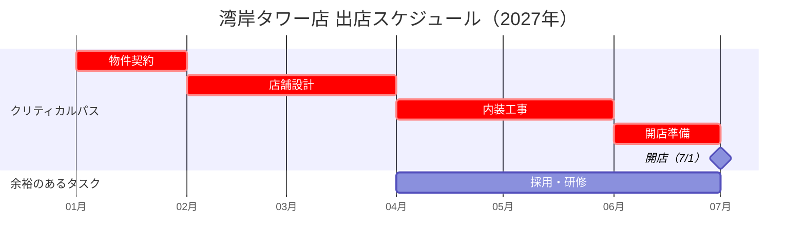

# 2027年度 新規出店計画 ― 首都圏ベイエリア 候補地の評価と出店判断

## 概要

- 首都圏ベイエリアの6エリアを「昼間人口・競合店舗数・平均賃料」で評価し、5つの候補地を比較した出店計画。
- 収支シミュレーションの結果、**湾岸タワー**（投資回収3.8年で最短）と**中央駅前**（年間売上96百万円で最大）を優先候補とした。
- 湾岸タワー店は2027年1月の物件契約から始めて **2027年7月1日に開店**する予定。目標は日商約24万円、年商8,800万円。
- 2店舗分の初期投資 **合計114百万円**（年間営業利益の見込みは合計27.6百万円）について決裁を依頼する。

---

## スライド1：2027年度 新規出店計画（表紙）

- 副題：首都圏ベイエリア 候補地の評価と出店判断
- 日付：2026年11月10日
- 作成：店舗開発部

---

## スライド2：出店エリアの評価

**キーメッセージ：** 6エリアを人口・競合・賃料の3指標で評価し、出店優先度を色分けした

### エリア別の出店優先度（図の塗り分けから読み取ったもの）

| エリア | 出店優先度 | 評価点の範囲 |
| --- | --- | --- |
| 中央 | 高 | 80以上 |
| 湾岸 | 高 | 80以上 |
| 東 | 中 | 60〜79 |
| 南 | 中 | 60〜79 |
| 北 | 低 | 60未満 |
| 西 | 低 | 60未満 |

凡例（出店優先度）：
- 高（評価点80以上）＝濃い茶色
- 中（60〜79）＝中間の茶色
- 低（60未満）＝薄いベージュ

### 評価指標（重み）

- 昼間人口（40%）
- 競合店舗数（30%）
- 平均賃料（30%）
- ※エリアごとの評価点は別紙

### 図の内容

6エリアの模式的な地図。配置はおおよそ次のとおり。北（左上）、東（右上）、西（左中段）、中央（中心）、南（下段左〜中央）、湾岸（右下）。各エリアが優先度の色で塗り分けられている。

---

## スライド3：候補地の比較

**キーメッセージ：** 昼間人口・競合店舗数・推定年商の3軸で5候補地を比較

### バブルチャート「候補地の比較（円の大きさ＝推定年商）」のデータ

（埋め込まれたグラフのデータから取得）

| 候補地 | 昼間人口（万人）＝横軸 | 競合店舗数（店）＝縦軸 | 推定年商（百万円）＝円の大きさ |
| --- | --- | --- | --- |
| 中央駅前 | 18.5 | 12 | 96 |
| 湾岸タワー | 9.2 | 3 | 88 |
| 東口商店街 | 7.4 | 6 | 52 |
| 南公園通り | 5.1 | 2 | 41 |
| 北大学前 | 6.3 | 4 | 58 |

- 横軸の目盛は0〜20万人、縦軸の目盛は0〜14店。
- 読み方：右ほど昼間人口が多く、上ほど競合が多い。円が大きいほど推定年商が大きい。
- 推定年商の値は収支シミュレーション（P6）の値と同じ。

### グラフから読み取れること

- 中央駅前は昼間人口が飛び抜けて多い（18.5万人）が、競合も最も多い（12店）。
- 湾岸タワーは昼間人口が2番目に多く（9.2万人）、競合が少ない（3店）。それでいて推定年商は2番目に大きい（88百万円）。

---

## スライド4：候補地② 湾岸タワー1階 現地写真

**キーメッセージ：** 駅から徒歩4分。前面道路の通行量は平日昼で1時間あたり約1,100人

### 区画の概要

- 1階の路面区画
- 前面はガラス張り
- 地下鉄駅の出口から徒歩4分

### 現地調査の所見

- オフィスワーカーの通行が多い
- 夜間（20時以降）は通行量が大きく減る

### 図・画像の内容

- 画像の代替テキスト：「湾岸タワー1階の候補区画の外観（2026年10月撮影）」
- ビルの外観を描いたイラスト。上階に窓が並び、1階には大きなガラス張りの区画がある。そこに「**テナント募集　1F 82㎡**」と書かれた赤枠の看板が掲示されている。この82㎡は、スライド8の店舗面積と一致する。

---

## スライド5：候補地の位置

**キーメッセージ：** 既存店と候補地の位置関係（番号は下表に対応）

| 番号 | 名称 | 区分 |
| --- | --- | --- |
| ① | 北大学前 | 候補地 |
| ② | 湾岸タワー | 候補地 |
| ③ | モリノカフェ 中央店 | 既存店 |
| ④ | 南公園通り | 候補地 |
| ⑤ | 中央駅前 | 候補地 |

※東口商店街は地図の範囲外（中央駅の東約2km）

### 地図画像の内容

- 道路が碁盤の目状に走る簡略地図。北は上（方位記号Nが右上にある）。
- 地図の中央からやや右を、「川」が南北に流れている。「中央駅」を通る線路が東西に走り、川を横切っている。
- 凡例：赤丸＝既存店、青丸＝出店候補地
- 各地点の位置（地図から読み取ったもの）：
  - ① 北大学前（青）：地図の北西。線路より北で、川より西。
  - ② 湾岸タワー（青）：地図の北東。線路より北で、川より東。
  - ⑤ 中央駅前（青）：中央駅のすぐ南。川より西。
  - ③ モリノカフェ 中央店（赤・既存店）：⑤中央駅前のさらに南西。
  - ④ 南公園通り（青）：地図の南東。線路より南で、川より東。

---

## スライド6：収支シミュレーション

**キーメッセージ：** 湾岸タワーは投資回収が最も早く、中央駅前は売上規模が最大

単位：百万円（投資回収年数を除く）

| 区分 | 候補地 | 初期投資：内装 | 初期投資：設備 | 年間売上 | 年間営業利益 | 投資回収年数 |
| --- | --- | ---: | ---: | ---: | ---: | ---: |
| 優先候補 | 湾岸タワー | 38 | 16 | 88 | 14.2 | 3.8年 |
| 優先候補 | 中央駅前 | 42 | 18 | 96 | 13.4 | 4.5年 |
| 次点 | 北大学前 | 30 | 14 | 58 | 7.1 | 6.2年 |
| 次点 | 東口商店街 | 28 | 13 | 52 | 5.9 | 6.9年 |
| 次点 | 南公園通り | 26 | 12 | 41 | 4.8 | 7.9年 |

- 元の表では「区分」列のセルが結合されている。優先候補は湾岸タワーと中央駅前、次点は北大学前・東口商店街・南公園通り。見出しも2段で、「初期投資」の下に内装・設備、「年間」の下に売上・営業利益がある。
- 投資回収年数＝初期投資合計÷年間営業利益
- 初期投資合計（内装＋設備）：湾岸タワー54、中央駅前60、北大学前44、東口商店街41、南公園通り38（スライド10の初期投資と一致）

---

## スライド7：出店までのスケジュール（湾岸タワー店）

**キーメッセージ：** 赤のタスクが遅れると開店日が遅れる

### ガントチャート（バーの位置から読み取った期間）

| タスク | 期間（2027年） | 区分 | 前のタスク（このタスクが終わってから開始） |
| --- | --- | --- | --- |
| 物件契約 | 1月 | クリティカルパス（赤） | ― |
| 店舗設計 | 2月〜3月 | クリティカルパス（赤） | 物件契約 |
| 内装工事 | 4月〜5月 | クリティカルパス（赤） | 店舗設計 |
| 採用・研修 | 4月〜6月 | 余裕のあるタスク（青） | 店舗設計 |
| 開店準備 | 6月 | クリティカルパス（赤） | 内装工事 |
| 開店 | 7月1日（マイルストーン◆） | ― | 開店準備 |

- 凡例：赤＝クリティカルパス、青＝余裕のあるタスク
- 矢印は「前の作業が終わってから次の作業を開始」を表す。図中の矢印は次の5本。
  - 物件契約 → 店舗設計
  - 店舗設計 → 内装工事
  - 店舗設計 → 採用・研修
  - 内装工事 → 開店準備
  - 開店準備 → 開店
- 採用・研修だけが青（余裕あり）で、開店日に影響しない。

---

## スライド8：湾岸タワー店の店舗計画

**キーメッセージ：** 日商約24万円、年商8,800万円を目標とする

### 店舗概要

- 店舗面積：82m²（約25坪）
- 客席数：48席（うちテラス8席）
- 営業時間：7:00〜21:00
- 定休日：なし

### 目標と条件

- 1日の来客数：355人 ※1
- 客単価：680円
- 出店条件：**家賃は売上の10%以内**（スライド上では太字・黄色の蛍光ペンで強調）
- 人員：社員2名＋アルバイト14名

※1 平日・休日の加重平均

（参考：355人×680円＝約24.1万円/日。365日で約8,800万円/年となり、キーメッセージおよびスライド6の年間売上88百万円と一致する）

---

## スライド9：参考資料

### 外部資料（ハイパーリンク）

- [商圏データの詳細（外部サイト）](https://data.morino-cafe.example/area2027)
- [競合店舗リスト（社内ポータル）](https://portal.morino-cafe.example/store-dev/competitors)

### スライド内リンク

- ボタン「収支の詳細はこちら」：クリックすると**スライド6「収支シミュレーション」**へ移動する（「クリックすると該当スライドへ移動します」と注記あり）。

---

## スライド10：決裁依頼

**キーメッセージ：** 2店舗の出店についてご承認をお願いします

| 店舗 | 初期投資 | 開店予定 | 年間営業利益（見込み） |
| --- | --- | --- | --- |
| 湾岸タワー店 | 54百万円 | 2027年7月1日 | 14.2百万円 |
| 中央駅前店 | 60百万円 | 2027年10月 | 13.4百万円 |
| **合計** | **114百万円** | ― | **27.6百万円** |

> ### ⚠ 取扱注意（発表者ノート）
> 中央駅前は現在賃料交渉中。月額賃料が85万円を超える場合は出店を見送り、次点の北大学前を再検討する。
>
> ※交渉中の条件（賃料の上限）を含むため、社外や交渉相手に共有しないこと。
