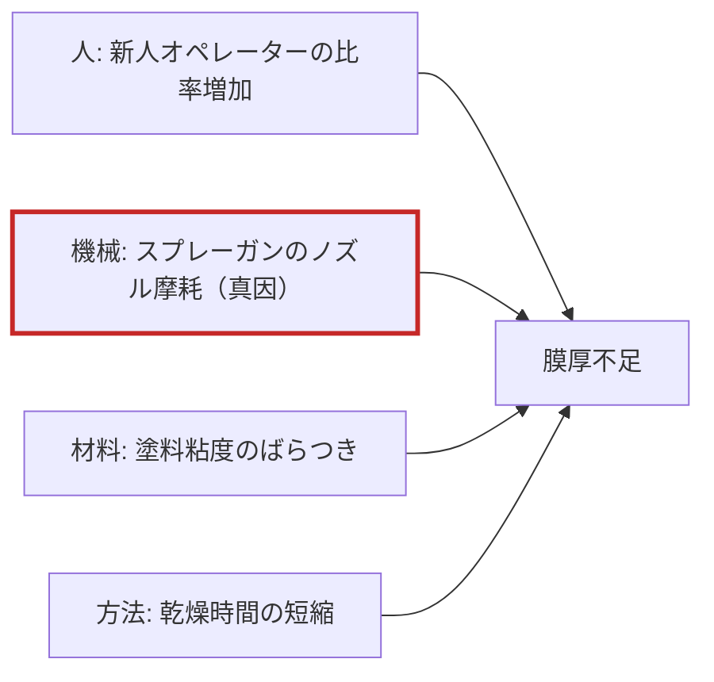
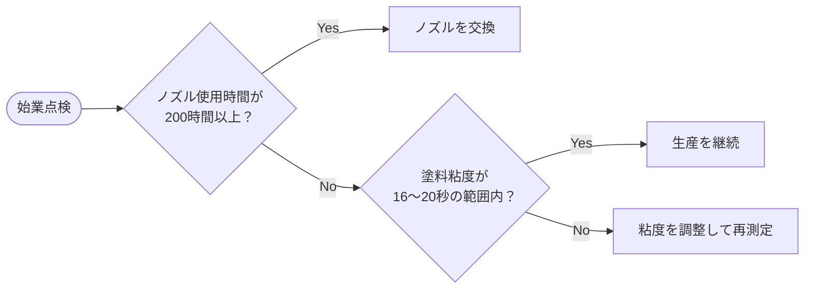

# 塗装ライン 品質改善報告

> 各スライド下部のフッター「社外秘　© 2026 株式会社ハヤセ工業」とページ番号は全スライド共通のため、以下では省略しています。

## 概要

- 第2工場Cラインで10月の塗装ムラ発生率が **3.8%**（目標1.0%以下）となり、不具合の上位は「膜厚不足」「異物付着」（上位2項目で全体の75%）。
- 特性要因図（4M）と設備点検の結果、**スプレーガンのノズル摩耗**を真因と判断（点検では塗料粘度も基準外）。
- 対策（ノズルの200時間ごと交換・塗料粘度の自動測定と警報・膜厚測定の再教育）により、膜厚ばらつき σ 4.8μm→1.9μm、Cpk 0.71→1.45。
- 対策後（11月13日〜17日）の不良率は **0.9%** で目標達成。対策は第1工場A・Bラインへ横展開中（第1工場Bラインの粘度自動測定は未着手）。

---

## スライド1：塗装ライン 品質改善報告（表紙）

- 副題：第2工場 Cライン「塗装ムラ」不具合の原因と対策（8Dレポート）
- 日付：2026年11月18日
- 作成：品質保証部

---

## スライド2：不具合の概要

**キーメッセージ：** 10月の塗装ムラ発生率は3.8%で、目標（1.0%以下）を大きく上回った

### 発生状況
- 発生率：3.8%（目標 1.0%以下）
- 対象：冷蔵庫用 外装パネル
- 発生期間：10月1日〜10月31日
- 流出：なし（全数検査で検出）

### 初動対応
- 全数検査を継続
- 吐出圧力は管理範囲内（緑帯）であることを確認

### 図・画像の内容
- 写真：塗装ブースの吐出圧力計（11月12日撮影）
- 単位 MPa、目盛 0.0〜1.0 MPa のアナログ圧力計。
- 緑色の帯（管理範囲）はおよそ 0.3〜0.5 MPa の位置に表示され、針は約 0.4 MPa を指しており緑帯の内側にある。
  - ※要確認：数値は写真の目盛からの読み取り。スライド6の点検記録では吐出圧の基準は 0.40±0.05MPa、11/12の実測は 0.42MPa。

---

## スライド3：不具合の内訳（パレート図）

**キーメッセージ：** 上位2項目で全体の4分の3を占める

### グラフ：不具合件数と累積比率（10月）
棒グラフ＝件数（左軸、0〜60）、折れ線＝累積比率（右軸、0〜100%）

| 不具合項目 | 件数 | 累積比率（%） |
| --- | ---: | ---: |
| 膜厚不足 | 48 | 48 |
| 異物付着 | 27 | 75 |
| タレ | 14 | 89 |
| 色ムラ | 7 | 96 |
| その他 | 4 | 100 |
| **合計** | **100** | — |

### 集計条件
- 10月の不具合品 100件
- 1件に複数の不具合がある場合は主要な1項目で集計

凡例：棒＝件数（左軸）／折れ線＝累積比率（右軸）

---

## スライド4：原因分析（特性要因図）

**キーメッセージ：** 4M（人・機械・材料・方法）で要因を洗い出し、真因を特定した

### 特性要因図（フィッシュボーン）の内容
特性（結果）：**膜厚不足**

- 人
  - 新人オペレーターの比率増加
- 機械
  - **スプレーガンのノズル摩耗** 🔴（赤丸＝真因）
- 材料
  - 塗料粘度のばらつき
- 方法
  - 乾燥時間の短縮

凡例：赤丸＝検証の結果、真因と判断した要因（図中で赤丸が付いているのは「スプレーガンのノズル摩耗」のみ）

---

## スライド5：膜厚の管理図（11月1日〜12日）

**キーメッセージ：** 管理限界を外れた日が1日あり、ノズル摩耗の進行と一致した

### グラフ：塗装膜厚の推移（日平均）
折れ線グラフ（縦軸 38〜58μm）。UCL・LCL は赤破線、CL は灰色破線。

| 日 | 膜厚（μm） | 上方管理限界 UCL | 中心線 CL | 下方管理限界 LCL |
| --- | ---: | ---: | ---: | ---: |
| 1日 | 52 | 56 | 50 | 44 |
| 2日 | 50 | 56 | 50 | 44 |
| 3日 | 53 | 56 | 50 | 44 |
| 4日 | 49 | 56 | 50 | 44 |
| 5日 | 51 | 56 | 50 | 44 |
| 6日 | 47 | 56 | 50 | 44 |
| 7日 | 45 | 56 | 50 | 44 |
| 8日 | 46 | 56 | 50 | 44 |
| **9日** | **43**（LCL 44 を下回る） | 56 | 50 | 44 |
| 10日 | 48 | 56 | 50 | 44 |
| 11日 | 55 | 56 | 50 | 44 |
| 12日 | 51 | 56 | 50 | 44 |

- 管理限界を外れたのは **11月9日（43μm、LCL割れ）**。6日〜9日にかけて膜厚が低下傾向。
- 管理限界は過去3か月のデータから算出
- 11日に膜厚が急増しているのはノズル交換直後の調整による

---

## スライド6：設備点検の記録

**キーメッセージ：** 点検で2項目が基準外となった（記録表の原本スキャン）

### 図・画像の内容（記録表スキャンの書き起こし）
**塗装設備 点検記録表**
- ライン：第2工場 Cライン
- 点検日：11/12（手書き）
- 点検者：山岸（手書き）

| 項目 | 基準 | 実測 | 判定 |
| --- | --- | --- | --- |
| ノズル径 | 1.30±0.05mm | 1.52mm | × |
| 吐出圧 | 0.40±0.05MPa | 0.42MPa | ○ |
| 塗料粘度 | 18±2秒 | 21秒 | × |
| ブース温度 | 23±3℃ | 24℃ | ○ |

- 備考：ノズル交換を依頼済（手書き）
- 基準外（×）は「ノズル径」と「塗料粘度」の2項目。

### 点検の目的
特性要因図で挙げた要因のうち、設備・材料に関わるものを実測で確認する

### 結論
基準外の項目を真因の候補として対策を実施（P7）

---

## スライド7：対策と効果

**キーメッセージ：** ノズルの定期交換と粘度の自動測定により、膜厚のばらつきを大幅に低減

### 実施した対策
1. スプレーガンのノズルを使用200時間ごとに交換
2. 塗料粘度を自動測定し、範囲外で警報
3. オペレーター向けに膜厚測定の再教育

### 効果
- 膜厚のばらつき（σ）：4.8μm → 1.9μm
- 工程能力指数 Cpk：0.71 → 1.45
- ※工程能力の目標は1.33以上

### 図・画像の内容
- 「対策前」「対策後」の塗装パネル写真（青色パネルの模式的な写真）を左右に並べて比較。
  - 対策前：パネル表面に明暗の異なる大小の円形のムラが多数見られる。
  - 対策後：ムラはごく小さな斑点が数か所残る程度で、ほぼ均一な塗装面。

---

## スライド8：日常管理の判断フロー

**キーメッセージ：** 始業点検時に以下のフローで判断する

文章での手順：
1. 始業点検を行う。
2. ノズル使用時間が200時間以上か？
   - Yes → ノズルを交換（赤色のボックス）
   - No → 次の判断へ
3. 塗料粘度が16〜20秒の範囲内か？
   - Yes → 生産を継続（緑色のボックス）
   - No → 粘度を調整して再測定（橙色のボックス）

※図上では「ノズルを交換」「粘度を調整して再測定」の後の矢印（どこへ戻るか）は描かれていない。

---

## スライド9：効果の確認（11月13日〜17日）

**キーメッセージ：** 対策後の不良率は0.9%となり、目標の1.0%以下を達成

### グラフ：対策後の不良内訳（件）（ドーナツグラフ、中央に「対策後 不良率 0.9%」）

| 不具合項目 | 件数 |
| --- | ---: |
| 膜厚不足 | 3 |
| 異物付着 | 4 |
| タレ | 2 |
| その他 | 1 |
| **合計** | **10** |

※対策後の内訳に「色ムラ」の項目はない。

### 評価
- 膜厚不足は48件（10月）から大幅に減少
- 異物付着は対策の対象外で、次の改善テーマとする

生産数：1,110個（5日間）　→ 不良10件 ÷ 1,110個 ≒ 0.9%

---

## スライド10：横展開の状況

**キーメッセージ：** 同じ設備を使う他ラインにも対策を展開する

| 工場 | ライン | ノズル定期交換 | 粘度の自動測定 | 作業者の再教育 |
| --- | --- | --- | --- | --- |
| 第1工場 | Aライン | 済 | 済 | 済 |
| 第1工場 | Bライン | 済 | **未**（赤字で強調） | 済 |
| 第2工場 | Cライン | 済 | 済 | 実施中 |

※元スライドでは「第1工場」のセルがA・Bラインの2行で結合されている。

凡例
- 済：完了
- 実施中：作業中
- 未：未着手

### 発表者ノート
第1工場Bラインの粘度自動測定は、2027年2月の設備更新に合わせて実施する予定。
