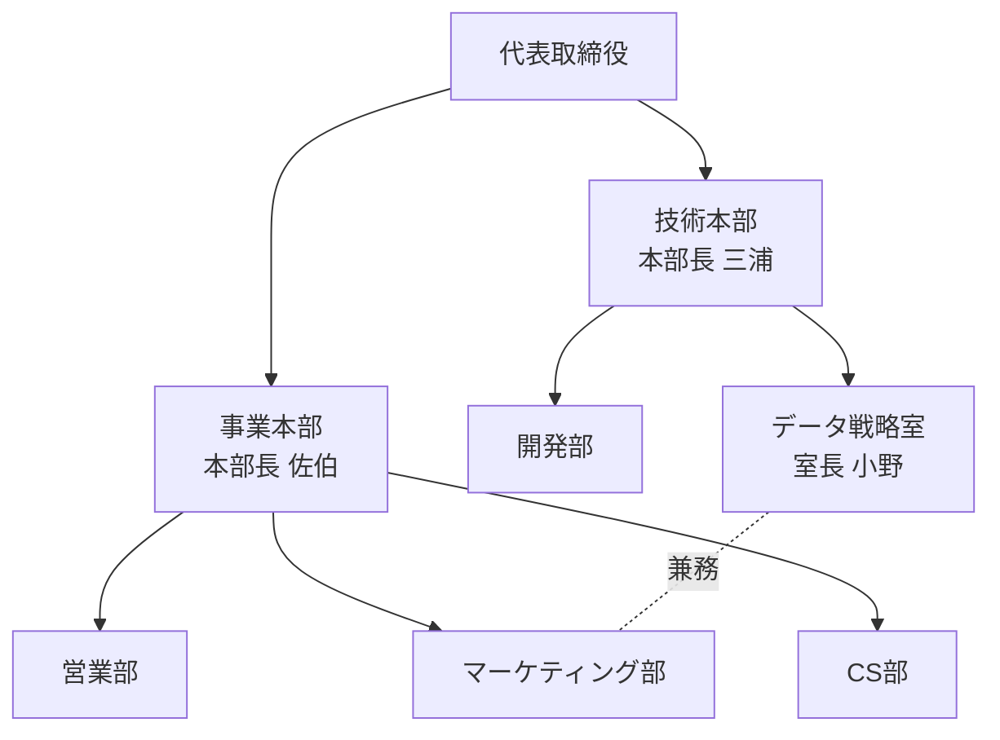

# 2027年度 組織再編案 ― 顧客起点の組織への移行

> 全スライド共通フッター：「社外秘　© 2026 株式会社ソラテック」＋ページ番号。右上に「Ver.3.2（2026/11/02 改訂）」。以下では各スライドへの記載を省略する。

## 概要

- 営業部・マーケティング部・CS部の3部門で業務重複（全75件中、複数部門の重複が33件）が多く、責任の所在が曖昧になっている。現場ヒアリングでは「意思決定が遅い」「顧客情報が分散」「評価が不透明」の3課題に集約された。
- 2027年4月1日付で **2本部制（事業本部・技術本部）** に移行し、技術本部の下に **データ戦略室（室長 小野）** を新設する。データ関連業務の説明責任をデータ戦略室に集約する。
- 旧組織から新組織へ人員を移動（例：旧営業部から25名を新CS部へ、旧マーケ10名＋旧開発8名をデータ戦略室へ）。新オフィス3階はフリーアドレス席（80席）中心。
- 決裁事項は「新組織（2本部制・データ戦略室の新設）の承認」。施行日 2027年4月1日、全社説明会 2026年12月1日。

---

## スライド1：2027年度 組織再編案（表紙）

- タイトル：2027年度 組織再編案
- 副題：顧客起点の組織への移行
- 日付：2026年11月
- 作成：経営企画部

---

## スライド2：部門間の業務重複

**キーメッセージ**：3部門で重複している業務が多く、責任の所在が曖昧になっている

### 本文（ベン図の内容）

営業部・マーケティング部・CS部の3つの円によるベン図。数字は業務の件数。

| 領域 | 業務件数 |
| --- | ---: |
| 営業部のみ | 18 |
| マーケティング部のみ | 10 |
| CS部のみ | 14 |
| 営業部 ∩ マーケティング部（2部門重複） | 12 |
| 営業部 ∩ CS部（2部門重複） | 9 |
| マーケティング部 ∩ CS部（2部門重複） | 7 |
| 3部門すべてで重複 | 5 |
| **合計** | **75** |

- 単独部門の業務：42件、複数部門で重複する業務：33件（2部門重複28件＋3部門重複5件）※スライド上の数値からの集計
- 部門別の関与件数（集計）：営業部 44件、マーケティング部 34件、CS部 35件

### 注記
- 読み方：数字は業務の件数。円が重なる部分は、複数部門が同じ業務を行っていることを示す
- 調査対象：業務一覧（全75件）

---

## スライド3：現場の声（ヒアリング結果の親和図）

**キーメッセージ**：現場の声は3つの課題に集約される

### 本文（親和図：見出しごとの付箋）

| 課題（見出し） | 現場の声（付箋） |
| --- | --- |
| 意思決定が遅い | ・承認に3段階必要 ・会議が多く決まらない ・部門長不在で止まる |
| 顧客情報が分散 | ・顧客リストが部署ごとに別 ・問い合わせ履歴が共有されない ・同じ顧客に重複して連絡 ・Excel管理が限界 |
| 評価が不透明 | ・評価基準が部署で違う ・成果が見えにくい |

※ 付箋は近くの見出しのグループに属する（付箋は黄色、一部重なって配置）

---

## スライド4：部門別の人員とDX成熟度

**キーメッセージ**：CS部のDX成熟度が最も低く、データ活用人材が不足している

| 部門 | 人員 | うちDX人材 | DX人材比率（参考・算出値） | DX成熟度（★5段階） |
| --- | ---: | ---: | ---: | --- |
| 営業部 | 120名 | 6名 | 5.0% | ★★☆☆☆（2/5） |
| マーケティング部 | 40名 | 9名 | 22.5% | ★★★★☆（4/5） |
| CS部 | 35名 | 2名 | 5.7% | ★☆☆☆☆（1/5） |
| 開発部 | 60名 | 24名 | 40.0% | ★★★★★（5/5） |

- DX成熟度：★5段階（2026年9月 社内アセスメント）
- ※ DX成熟度はスライド上では星の画像（黄＝点灯、灰＝消灯）で表示。DX人材比率は本ナレッジ化時の算出値でスライドには記載なし。

---

## スライド5：新組織図

**キーメッセージ**：2本部制とし、データ戦略室を技術本部の下に新設する

- 代表取締役
  - 事業本部（本部長 佐伯）：営業部／マーケティング部／CS部
  - 技術本部（本部長 三浦）：開発部／データ戦略室（室長 小野）
- 凡例：実線＝指揮命令、オレンジ破線＝兼務（室長が部長を兼ねる）
- 破線はマーケティング部とデータ戦略室を結んでいる → **データ戦略室長（小野）がマーケティング部長を兼務**（図の線の位置から判読。スライド本文に明記はなし）

---

## スライド6：役割分担（RACI）

**キーメッセージ**：データ関連業務の説明責任をデータ戦略室に集約する

| 区分 | 業務 | 事業本部 | 技術本部 | データ戦略室 | 経営企画部 |
| --- | --- | :-: | :-: | :-: | :-: |
| データ | 顧客データ基盤の運用 | C | R | A | I |
| データ | KPIレポーティング | I | I | R | A |
| 企画 | 新規事業の企画 | R | C | C | A |
| 企画 | 予算策定 | C | C | I | A/R |

- 凡例：R：実行責任　A：説明責任（最終決定者）　C：協議先　I：報告先
- ※元スライドでは「区分」列がセル結合（データ：2行、企画：2行）

> ※要確認：キーメッセージは「データ関連業務の説明責任をデータ戦略室に集約」だが、データ区分の「KPIレポーティング」のA（説明責任）は経営企画部、データ戦略室はRとなっている。

---

## スライド7：人員の移動計画

**キーメッセージ**：旧組織から新組織への人員移動（2027年4月1日付）

| 旧組織（人員） | 移動先（新組織） | 人数 |
| --- | --- | ---: |
| 旧 営業部（120名） | 営業部 | 95名 |
| 旧 営業部（120名） | CS部 | 25名 |
| 旧 マーケティング部（40名） | マーケティング部 | 30名 |
| 旧 マーケティング部（40名） | データ戦略室 | 10名 |
| 旧 開発部（60名） | データ戦略室 | 8名 |
| 旧 開発部（60名） | 開発部 | 52名 |
| 旧 CS部（35名） | CS部 | 35名（全員） |

※ 旧CS部（35名）は全員が新CS部へ移る（スライド注記。図には矢印なし）

**新組織の人員（スライドの数値からの集計・参考）**

| 新組織 | 人員 | 内訳 |
| --- | ---: | --- |
| 営業部 | 95名 | 旧営業95 |
| CS部 | 60名 | 旧営業25＋旧CS35 |
| マーケティング部 | 30名 | 旧マーケ30 |
| データ戦略室 | 18名 | 旧マーケ10＋旧開発8 |
| 開発部 | 52名 | 旧開発52 |
| 合計 | 255名 | 旧組織合計 255名（120＋40＋35＋60）と一致 |

---

## スライド8：新オフィスのレイアウト（3階）

**キーメッセージ**：部門の壁をなくすため、フリーアドレス席を中心に配置する

### 図の内容（3F平面図・画像）
- 上段（左から）：会議室A（定員12名）／会議室B（定員6名）／データ戦略室／受付
- 中段：EV（エレベーター）、その右に通路と思われる空きスペース
- 下段左：事業本部エリア（広めの区画）
- 下段右：フリーアドレス席（80席）※図中の席の四角は30個で模式表示

### ポイント
- データ戦略室は受付の隣に配置
- 会議室は2室
- 事業本部の固定席は窓側

> ※要確認：平面図には窓の位置が描かれておらず、「事業本部の固定席は窓側」を図から確認できない。

---

## スライド9：移行タスクの進捗

**キーメッセージ**：6つの移行タスクのうち2つが完了

| ステータス | タスク |
| --- | --- |
| 準備中（灰） | 新任管理職研修／名刺・メール署名の変更 |
| 実施中（橙） | 人事システムの設定変更／座席レイアウトの決定 |
| 完了（緑） | 就業規則の改定／新組織の社内発表 |

※元スライドはカンバン形式（列＝ステータス、カード＝タスク）

---

## スライド10：決裁事項とスケジュール

| 項目 | 内容 |
| --- | --- |
| 決裁事項 | 新組織（2本部制・データ戦略室の新設）の承認 |
| 施行日 | 2027年4月1日 |
| 社内発表 | 2026年12月1日（実施済みの社内発表とは別に全社説明会を開催） |

> **⚠ 取扱注意（発表者ノート）**
> 労働組合への説明は11月25日に実施済みで、大きな異論は出ていない。
> （労使関係に関する内部情報。スライド本文には記載されていない。共有範囲に注意）

> ※要確認：
> - スライド9では「新組織の社内発表」が完了済み。一方スライド10の「社内発表」欄は2026年12月1日（全社説明会）で、「実施済みの社内発表とは別に」と補足されている。既に実施済みの社内発表の実施日はどこにも記載がない。
> - 版数は「2026/11/02 改訂」だが、ノートには11月25日実施済みの事項が記載されており、ノートと本文の更新時点が異なる可能性がある。
