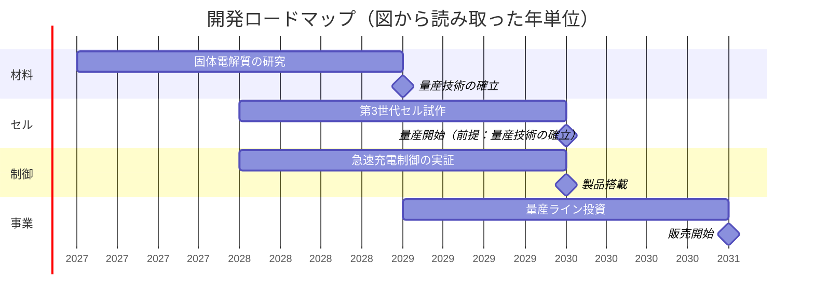
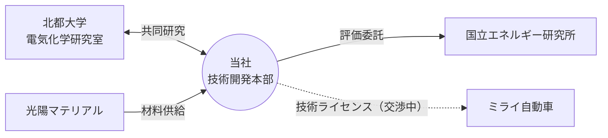

# 次世代バッテリー 技術開発ロードマップ

| 項目 | 内容 |
| --- | --- |
| 副題 | 第3世代 全固体電池セルの開発計画（2027〜2031年） |
| 日付 | 2026年11月 |
| 作成部署 | 技術開発本部 |
| 会社 | 株式会社アストラエナジー |
| 機密区分 | 社外秘（全スライドのフッター：「社外秘　© 2026 株式会社アストラエナジー」＋ページ番号） |
| 元ファイル | 10_次世代バッテリー技術開発ロードマップ.pptx（アップロード時のファイル名：98d5c533-10_____________.pptx） |
| 総スライド数 | 10枚 |

## 概要

- 第3世代の全固体電池セル（高ニッケル正極NMC811＋Si/C複合負極＋硫化物系固体電解質）を2027〜2031年に開発する計画。
- 目標性能はサイクル寿命10,000回（第2世代の5倍）、重量エネルギー密度420 Wh/kg（競合の最高値350 Wh/kgを2割上回る）。
- 実用化判断の基準（TRL6以上）を満たしている要素技術は、高ニッケル正極と急速充電制御の2つ。固体電解質の量産技術の確立（2029年）がセル量産開始（2030年）の前提条件。
- 開発予算は2029年度が最大の23億円（量産ライン投資が集中）。5年間の合計は84億円（グラフの値から算出）。2029年度予算には補助金の採択が前提となっている（発表者ノート）。

---

## スライド1：表紙

- タイトル：次世代バッテリー 技術開発ロードマップ
- 副題：第3世代 全固体電池セルの開発計画（2027〜2031年）
- 2026年11月／技術開発本部

---

## スライド2：世代別の充放電サイクル寿命

**キーメッセージ：** 第3世代では、サイクル寿命を第2世代の5倍に高める

**グラフ：充放電サイクル寿命（回）**（折れ線グラフ。※縦軸は対数目盛（底10）で、100〜100,000の範囲）

| 世代 | サイクル寿命（回） |
| --- | --- |
| 第1世代 | 500 |
| 第2世代 | 2,000 |
| 第3世代（開発中） | 10,000 |
| 最終目標 | 50,000 |

**用語の定義**
- **サイクル寿命**：容量が初期の80%に下がるまでに繰り返せる充放電の回数

**補足**
- 最終目標は、2031年以降の第4世代で達成を目指す

---

## スライド3：エネルギー密度の競合比較

**キーメッセージ：** 開発中の第3世代は、競合の最高値を2割上回る

**グラフ：重量エネルギー密度（Wh/kg）**（横棒グラフ。軸は0〜450）

| 対象 | エネルギー密度（Wh/kg） |
| --- | --- |
| 当社 第3世代（開発中） | 420 |
| A社 | 350 |
| B社 | 310 |
| C社 | 280 |

（420 ÷ 350 ＝ 1.2で、競合の最高値であるA社を20%上回る）

**単位：** Wh/kg（Wh·kg⁻¹）

**出典：** 競合の値は各社の公開資料による（2026年9月時点）

---

## スライド4：第3世代セルの材料構成

**キーメッセージ：** 高ニッケル正極とシリコン系負極を組み合わせる

| 部材 | 材料 |
| --- | --- |
| 正極材 | LiNi₀.₈Mn₀.₁Co₀.₁O₂（NMC811） |
| 負極材 | Si/C複合材（Si含有率 15wt%） |
| 固体電解質 | 硫化物系 Li₆PS₅Cl |

**容量維持率**

> 容量維持率 ＝ C₅₀₀ ÷ C₁ × 100 ＝ 92.4%
> （Cₙ：nサイクル目の放電容量）

（500サイクル目の放電容量は、1サイクル目の92.4%）

**材料選定の理由**（右側の囲み）
- ニッケル比率を高めて、エネルギー密度を向上
- コバルト使用量を削減し、調達リスクを低減
- 硫化物系電解質はイオン伝導度が高い

---

## スライド5：要素技術の成熟度（TRL）

**キーメッセージ：** 実用化判断の基準（TRL6以上）を満たすのは2技術

**図：要素技術ごとのTRL（横棒）**（TRL1〜9の目盛。TRL6とTRL7の境界に赤い破線で「実用化判断の基準」の線がある。基準を満たす技術は濃い色、満たさない技術は薄い色の棒で示されている）

| 要素技術 | 現在のTRL | 実用化判断の基準（TRL6以上） |
| --- | --- | --- |
| 固体電解質 | TRL5 | 未達 |
| 高ニッケル正極 | TRL7 | 達成 |
| シリコン系負極 | TRL4 | 未達 |
| 急速充電制御 | TRL6 | 達成 |

※TRLの値は、図の棒の終点の位置から読み取ったもの（スライドに数値の記載はない）。

**TRLの定義（スライド内の抜粋）**
- TRL1：基礎研究
- …
- TRL6：実環境に近い条件での実証
- …
- TRL9：量産・実用

---

## スライド6：開発ロードマップ

**キーメッセージ：** 固体電解質の量産技術確立が、第3世代セル量産の前提条件

**図：開発ロードマップ（2027〜2031年、4レーン）**

| レーン | 活動（期間） | マイルストーン（☆） |
| --- | --- | --- |
| 材料 | 固体電解質の研究（2027年〜2028年） | ☆量産技術の確立（2029年） |
| セル | 第3世代セル試作（2028年〜2029年） | ☆量産開始（2030年） |
| 制御 | 急速充電制御の実証（2028年〜2029年） | ☆製品搭載（2030年） |
| 事業 | 量産ライン投資（2029年〜2030年） | ☆販売開始（2031年） |

**前提関係（赤矢印）**
- 材料「☆量産技術の確立」（2029年）→ セル「☆量産開始」（2030年）
  - 固体電解質の量産技術が確立しないと、セルの量産を始められない

※期間とマイルストーンの年は、図の中での位置から読み取ったもの（月の単位の記載はない）。

**凡例：** ☆：マイルストーン　赤矢印：前提関係

---

## スライド7：共同研究・提携体制

**キーメッセージ：** 大学・材料メーカー・研究機関と連携し、量産後は自動車メーカーへ技術供与する

**図：提携関係図**（中心は「当社 技術開発本部」）

| 相手先 | 関係 | 矢印の向き（提供する側→受ける側） | 契約状況 |
| --- | --- | --- | --- |
| 北都大学 電気化学研究室 | 共同研究 | 当社 ⇄ 北都大学（双方向） | 契約済み（実線） |
| 光陽マテリアル | 材料供給 | 光陽マテリアル → 当社 | 契約済み（実線） |
| 国立エネルギー研究所 | 評価委託 | 当社 → 国立エネルギー研究所 | 契約済み（実線） |
| ミライ自動車 | 技術ライセンス | 当社 → ミライ自動車 | **交渉中**（破線、2027年度の契約を目指す） |

**凡例：** 実線：契約済み　破線：交渉中（2027年度の契約を目指す）　矢印の向き：提供する側→受ける側

---

## スライド8：第3世代セルの断面構造

**キーメッセージ：** 5層構造。番号は下表の各層に対応

**図：** セルの断面の模式図。上から①〜⑤の5層が積み重なっている（①灰色の薄い層、②濃い青の厚い層、③白い薄い層、④黒い厚い層、⑤銅色の薄い層）。

| 番号 | 層 | 厚み |
| --- | --- | --- |
| ① | 正極集電体（アルミ箔） | 15μm |
| ② | 正極 | 85μm |
| ③ | 固体電解質層 | 12μm |
| ④ | 負極 | 70μm |
| ⑤ | 負極集電体（銅箔） | 10μm |

（5層の合計の厚み：192μm。表の値から算出）

※図の層の厚みは模式的に表したもので、実際の比率とは異なる

---

## スライド9：特許の出願状況

**キーメッセージ：** 出願12件のうち5件が登録済み

| 技術 | 出願件数（国内） | 出願件数（海外） | 登録件数 |
| --- | --- | --- | --- |
| 固体電解質 | 3 | 2 | 1 |
| 高ニッケル正極 | 2 | 1 | 2 |
| シリコン系負極 | 2 | 0 | 1 |
| 急速充電制御 | 1 | 1 | 1 |
| **合計** | **8** | **4**※2 | **5** |

（元の表では「出願件数」が「国内」と「海外」の2列にまたがる結合見出しになっている。出願の合計は8＋4＝12件）

- ※1 件数は2026年10月末時点
- ※2 海外出願のうち2件は審査請求前

※要確認：「※1」の印は表の中のどこにも付いていない。表全体の件数についての注記と考えられる。

---

## スライド10：開発予算計画

**キーメッセージ：** 2029年度に量産ライン投資が集中し、予算が最大となる

**グラフ：年度別 開発予算（億円）**（積み上げ縦棒グラフ）

| 年度 | 人件費 | 設備投資 | 外部委託 | 合計 |
| --- | --- | --- | --- | --- |
| 2027年度 | 6 | 4 | 2 | 12 |
| 2028年度 | 7 | 6 | 2 | 15 |
| 2029年度 | 8 | 12 | 3 | **23** |
| 2030年度 | 8 | 9 | 3 | 20 |
| 2031年度 | 7 | 5 | 2 | 14 |
| 5年間の合計 | 36 | 36 | 12 | 84 |

（合計の列と行は、グラフの値から算出したもの。スライドに記載はない）

**補足**
- 5年間の総額は、別途取締役会で審議
- 設備投資には、量産ラインの建設費を含む

### ⚠ 取扱注意（発表者ノート）

> 2029年度の予算は、公的補助金（最大8億円）の採択を前提としている。不採択の場合は量産ライン投資を2030年度に繰り延べる。

（スライドの本文には書かれていない前提条件。2029年度の予算23億円と、スライド6のロードマップの量産ライン投資の時期が、補助金が採択されるかどうかで変わる可能性がある）
